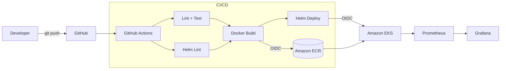

# TaskOps DevOps Platform

[](https://github.com/<your-username>/taskops-devops-platform/actions/workflows/ci-cd.yml)

An end-to-end DevOps project: a **Python FastAPI** service that is containerized, tested, built and shipped through **GitHub Actions** to **AWS (ECR + EKS)** with **Helm**, and observed with **Prometheus + Grafana**.

## Architecture



## Tech stack

| Area            | Tools                                                         |
|-----------------|---------------------------------------------------------------|
| Application     | Python 3.12, FastAPI, Uvicorn                                 |
| Testing/Quality | Pytest, pytest-cov, Ruff                                      |
| Containers      | Docker (multi-stage, non-root), Docker Compose                |
| CI/CD           | GitHub Actions, AWS OIDC (no long-lived keys)                 |
| Cloud           | AWS ECR, AWS EKS                                              |
| Kubernetes      | Helm chart (Deployment, Service, Ingress/ALB, HPA, ServiceMonitor) |
| Observability   | Prometheus, Grafana (provisioned dashboard)                   |

## Project structure

```
.
├── app/                    # FastAPI service
├── tests/                  # Pytest suite
├── helm/taskops/           # Helm chart
├── monitoring/             # Prometheus config + Grafana provisioning/dashboards
├── .github/workflows/      # CI/CD pipeline
├── Dockerfile
├── docker-compose.yml
└── Makefile
```

## API

| Method | Path             | Description           |
|--------|------------------|-----------------------|
| GET    | `/`              | Service info/version  |
| GET    | `/healthz`       | Liveness probe        |
| GET    | `/readyz`        | Readiness probe       |
| GET    | `/metrics`       | Prometheus metrics    |
| GET    | `/tasks`         | List tasks            |
| POST   | `/tasks`         | Create a task         |
| GET    | `/tasks/{id}`    | Get a task            |
| PUT    | `/tasks/{id}`    | Update a task         |
| DELETE | `/tasks/{id}`    | Delete a task         |

Interactive docs: `http://localhost:8000/docs`

## Run locally

### Python

```bash
python -m venv .venv && source .venv/bin/activate   # Windows: .venv\Scripts\activate
make install
make test
make run
```

### Docker Compose (app + Prometheus + Grafana)

```bash
make up
```

| Service    | URL                          |
|------------|------------------------------|
| API        | http://localhost:8000/docs   |
| Prometheus | http://localhost:9090        |
| Grafana    | http://localhost:3000 (admin / `$GF_ADMIN_PASSWORD`, default `admin`) |

The **TaskOps API** dashboard is auto-provisioned in Grafana (request rate, p95 latency, error rate, task count).

Generate some traffic:

```bash
for i in $(seq 1 50); do curl -s -X POST localhost:8000/tasks -H 'Content-Type: application/json' -d "{\"title\":\"task $i\"}" > /dev/null; done
```

## CI/CD pipeline

Defined in [.github/workflows/ci-cd.yml](.github/workflows/ci-cd.yml):

1. **Lint & Test** – Ruff lint/format check, Pytest with coverage.
2. **Helm Lint** – `helm lint` + `helm template` rendering.
3. **Build & Push** – Docker Buildx with GHA layer cache. On `main`, pushes `:<sha>` and `:latest` to ECR.
4. **Deploy** – `helm upgrade --install --atomic` to EKS, then verifies the rollout.

Pull requests run steps 1–3 without pushing. If AWS isn't configured, the pipeline still passes (build only).

### AWS setup

1. Create an ECR repository (e.g. `taskops-api`) and an EKS cluster.
2. Create an IAM OIDC identity provider for GitHub (`token.actions.githubusercontent.com`).
3. Create an IAM role trusted by your repo with permissions for ECR push and `eks:DescribeCluster`, and map it in the cluster (EKS access entry or `aws-auth`).
4. In GitHub → *Settings → Secrets and variables → Actions → Variables*, add:

| Variable         | Example                                         |
|------------------|-------------------------------------------------|
| `AWS_ROLE_ARN`   | `arn:aws:iam::123456789012:role/github-actions` |
| `AWS_REGION`     | `us-east-1`                                     |
| `ECR_REPOSITORY` | `taskops-api`                                   |
| `EKS_CLUSTER`    | `taskops-cluster`                               |

5. Create a `production` environment (optionally with required reviewers for manual approval).

## Kubernetes monitoring

Install the Prometheus Operator stack and enable the chart's `ServiceMonitor`:

```bash
helm repo add prometheus-community https://prometheus-community.github.io/helm-charts
helm install kube-prometheus-stack prometheus-community/kube-prometheus-stack -n monitoring --create-namespace

helm upgrade --install taskops helm/taskops -n taskops --set serviceMonitor.enabled=true
```

Then import [monitoring/grafana/dashboards/taskops-api.json](monitoring/grafana/dashboards/taskops-api.json) into Grafana.

## Security practices

- Multi-stage image, runs as non-root UID `10001`
- Read-only root filesystem, all Linux capabilities dropped, `RuntimeDefault` seccomp
- GitHub → AWS auth via OIDC, no static credentials stored
- Least-privilege workflow `permissions`

## Notes

The task store is in-memory to keep the focus on DevOps tooling; with multiple replicas each pod holds its own data. Swapping in PostgreSQL (e.g. Amazon RDS) is a natural next step.

## Roadmap

- [ ] Terraform for VPC / EKS / ECR
- [ ] Trivy image scanning + Dependabot
- [ ] PostgreSQL persistence
- [ ] GitOps with Argo CD
